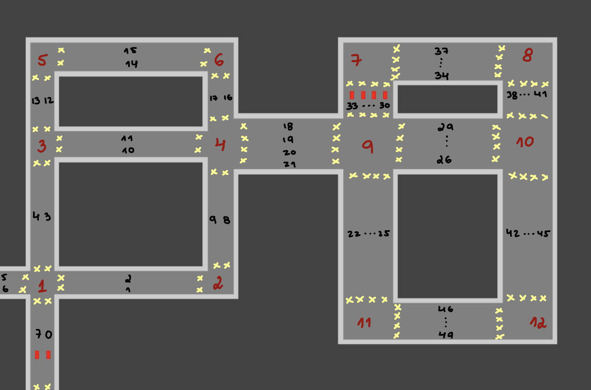

# CARLO Driving AI: Autonomous Agents at Intersections

A multi-agent traffic simulation in Python where **autonomous cars must navigate a city road network, cross shared intersections and reach their destination without crashing.** We built and compared four decision-making strategies, from naive to coordinated, and benchmarked them on arrival and collision rates.

Built as a team project on top of [Stanford ILIAD's CARLO](https://github.com/Stanford-ILIAD/CARLO), an open-source 2D driving simulator.



## The problem

When several cars approach the same intersection at once, someone has to yield. Each car is an independent agent that sees only the local state of the road and intersection. It has to decide **go or wait**, and it must do so in time to brake. A bad policy means collisions and gridlock, so the goal is to maximize cars that arrive and minimize cars that crash.

## Where we started

Upstream CARLO is a clean physics and rendering engine (bicycle-model car dynamics, collision detection, a tkinter GUI), but **cars were not agents**. The only way to drive was a human on the keyboard or a steering wheel. There was no road network, no routes, no notion of intersections and no autonomous behavior.

## What we built

| Area | Contribution |
|---|---|
| **Environment** | A city map of about 50 directed lanes and 13 intersections, with defined routes (paths) cars can follow, plus per-lane car tracking. |
| **Agent framework** | A reusable `AutonomousAgent` base class that turns high-level decisions into low-level `throttle` and `steering` controls. It handles waypoint following, 90° left and right turns, lane keeping, braking-distance estimation and following the car ahead. |
| **Intersection model** | An `Intersection` abstraction that tracks which cars are inside, which lane-to-lane movements are active, and a priority order between roads. |
| **Four agent types** | Greedy, Passive, Social and Phase (below), each a small subclass that only overrides the go/wait decision. |
| **Evaluation harness** | Runs many episodes per agent type with randomized routes and compares cars that arrived against cars that crashed, with bar plots and confidence intervals. |
| **Driving extras** | Reverse driving for manual control, added on top of the upstream keyboard controller. |

## The agents

Each agent shares the same driving skills. They differ only in **how they decide whether to enter an intersection**.

| Agent | Colour | Strategy | Intuition |
|---|---|---|---|
| **Greedy** | red | Never stops. Always accelerates. | Baseline: fastest in free traffic, but crashes when paths cross. |
| **Passive** | blue | Stops if the intersection is occupied, then waits a random time before retrying. | Safer, but uncoordinated. Randomized back-off breaks ties without communication. |
| **Social** | yellow | Uses road priority: yields to any car coming from a higher-priority road, and checks that nobody already crossing conflicts with it. | Deterministic coordination. Everyone follows the same rule, so no random waiting. |
| **Phase** | green | Intersections have pre-defined *phases*, which are sets of compatible movements that can run together. Cars "vote" for the phase that serves the most waiting cars, then go only if their movement belongs to it. | Traffic-light-like throughput without a central controller, since cars agree on the phase themselves. |

All non-greedy agents also brake for the car in front, using a physics-based braking-distance estimate, and decide in time to stop before the intersection.

## Skills demonstrated

- **Multi-agent systems:** decentralized decision-making, conflict resolution and coordination without central control
- **Simulation and control:** steering and throttle control, kinematic (bicycle) model, collision handling
- **Software design:** a clean base class and subclass hierarchy, with a shared environment kept separate from agent logic
- **Experimentation:** a repeatable benchmark that compares policies on explicit success and failure metrics
- **Teamwork:** four contributors working in parallel on environment, agents and phases (about 76 commits, including the upstream history)

## Run it

```bash
pip install numpy matplotlib
python3 gui.py
```

`gui.py` runs simulation episodes for each agent type and plots arrivals and collisions.

## Repository layout

```
gui.py                      # entry point: runs episodes, compares agent types
shared_variables.py         # road network, lane/intersection data, phases, paths, constants
autonomous_agents/
  autonomous_agents.py      # base agent: path following, turning, braking, car-following
  greedy.py                 # always-go baseline
  passive.py                # stop-and-retry with random back-off
  social.py                 # priority-based yielding
  phase_agent.py            # phase voting
intersection/intersection.py  # intersection state, occupancy and priority
agents.py, entities.py, world.py, geometry.py, graphics.py, visualizer.py
                            # CARLO engine (upstream), extended for our needs
interactive_controllers.py  # keyboard / steering-wheel control (upstream)
```

## Credits

Simulation engine: [CARLO](https://github.com/Stanford-ILIAD/CARLO) by Stanford ILIAD. The road network, intersection logic, agent framework, the four agent types and the benchmarking are our team's work.
